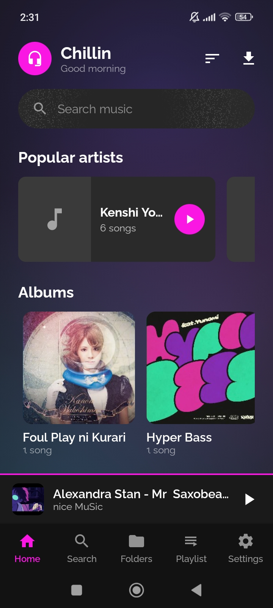
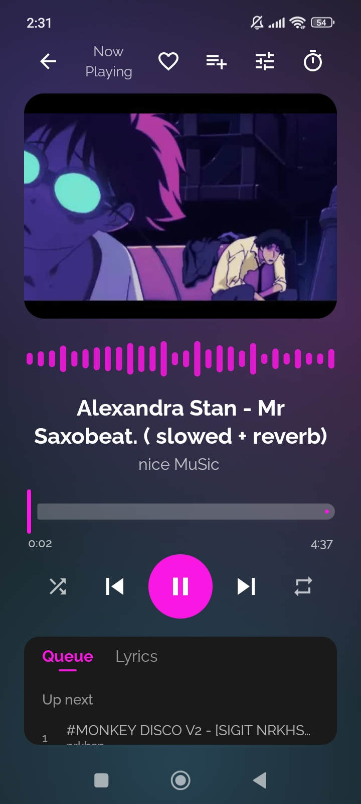
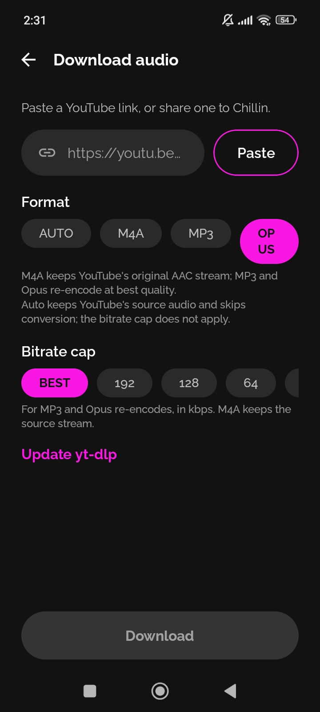
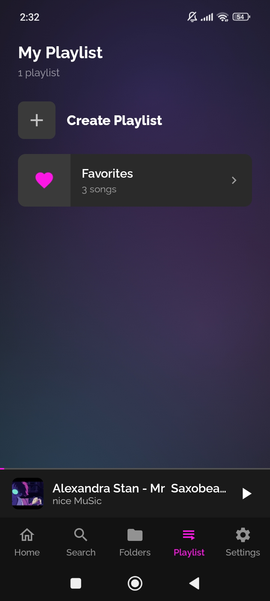
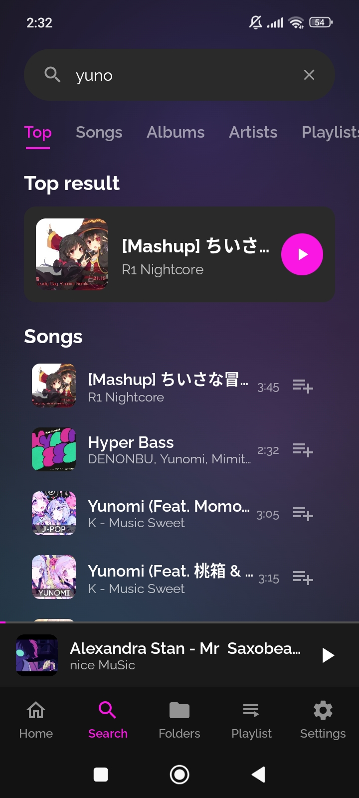

# Chillin — Public Releases

**Chillin** is an offline-first music player for Android. It plays the audio already on your device and can download audio from YouTube links into your public `Music/Chillin` folder. No accounts, no cloud library, no streaming service — playback works without a network connection.

## Screenshots

   
  <b>Home</b> — Your library at a glance, with popular artists and albums

   
  <b>Now Playing</b> — Queue, synced lyrics, and a background that follows the music

   
  <b>Download</b> — Paste a YouTube link, pick a format, and it lands in Music/Chillin

   
  <b>Playlists</b> — Local playlists, built from the songs on your device

   
  <b>Search</b> — Search songs, albums, artists, and playlists

## Features

- **Local library** — your device's music from MediaStore, with Home, Search, and playlists
- **Background playback** — Now Playing screen with queue, shuffle, repeat, and lock-screen controls
- **YouTube downloads** — M4A or MP3, single tracks or whole playlists, with a queue (pause, resume, retry)
- **Synced lyrics** — lyrics that follow the music
- **Radio** — song and artist radio
- **Smart Shuffle** — smarter shuffling for playlists
- **Speed dial** — pin albums and playlists to a shelf
- **Audio effects** — equalizer, 8D audio, reverb, and bass boost
- **Private by design** — offline-first, no account, local backup and restore

## Get the app

Download the latest signed APK from the **[Releases](https://github.com/Anjasfedo/chillin-releases/releases)** page and install it on your Android phone (Android 8.0 or newer, ±120 MB — the app bundles its download engine). Release builds install over previous versions, keeping your data.

## About this repo

This repository contains **only release artifacts** — the source code lives in a private repository. Each release is built here on GitHub Actions by checking out the private source with a read-only deploy key, compiling a signed release APK, and wiping the source from the runner before publishing. No source code is ever committed to this repo.

Builds are triggered manually per release tag (e.g. `v1.0-9f7d702`). Release notes come from the private repo's `CHANGELOG.md`.

Built with Kotlin, Jetpack Compose, Media3 ExoPlayer, and yt-dlp.
